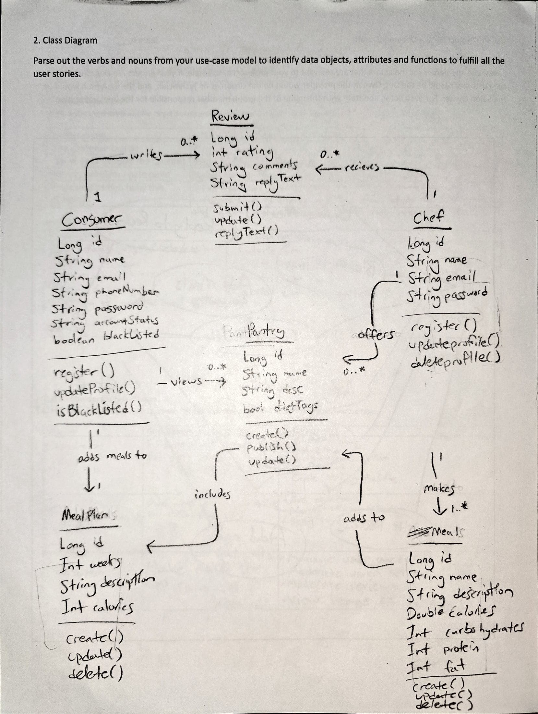

# MealPrepMatch Backend API


## UML Class Diagram
 


# API Overview
 
Base URL:
 
    local: http://localhost:8080/api
    production: https://mealprepmatch.onrender.com
 
> **Cold-start note:** Render's free tier puts the service to sleep after about 15 minutes of inactivity, so the first request afterward can take up to a minute.
 
JSON request bodies are validated. The endpoint tables list applicable error codes: 400 Bad Request for invalid input, 404 Not Found for missing resources, and 409 Conflict for duplicate records.
 
## Profile and discovery
 
| Method | Path | Purpose | Response code | Error codes | User story |
|---|---|---|---|---|---|
| POST | /api/consumers | Register a consumer profile | 201 Created | 400, 409 | US-1 |
| GET | /api/consumers | List all consumers | 200 OK | — | US-1 |
| GET | /api/consumers/{id} | Read a consumer profile | 200 OK | 404 | US-1 |
| PUT | /api/consumers/{id} | Update profile, diet preferences, and blacklist | 200 OK | 400, 404 | US-1 |
| DELETE | /api/consumers/{id} | Delete a consumer | 204 No Content | 404 | US-1 |
| POST | /api/chefs | Register a chef profile | 201 Created | 400 | US-5 |
| GET | /api/chefs | List all chefs | 200 OK | — | US-5 |
| GET | /api/diet-tags | List available diet tags | 200 OK | — | US-2 |
| GET | /api/blacklist-tags | List available blacklist tags | 200 OK | — | US-2 |
 
### Example Consumer Request
 
```
POST /api/consumers
Content-Type: application/json
 
{
  "name": "Jamie Carter",
  "email": "jamie@example.com",
  "password": "password123",
  "phoneNumber": "336-555-0142",
  "accountStatus": "ACTIVE",
  "preferredTags": ["VEGAN"],
  "blacklistedTags": ["PEANUTS"]
}
```
 
### Example Chef Request
 
```
POST /api/chefs
Content-Type: application/json
 
{
  "name": "Maria Lopez",
  "email": "maria@example.com",
  "phoneNumber": "336-555-0101",
  "bio": "Meal prep chef specializing in high-protein, gluten-free dishes."
}
```
 
Passwords are accepted only by registration endpoints, hashed with BCrypt, and never included in API responses. Authentication and authorization are not yet implemented; IDs in paths are not proof of identity and these endpoints must not be exposed to untrusted clients until access control is added.
 
## Meals and meal plans
 
| Method | Path | Purpose | Response code | Error codes | User story |
|---|---|---|---|---|---|
| POST | /api/meals/chef/{chefId} | Chef adds a meal to the catalog | 201 Created | 400, 404 | US-6 |
| GET | /api/meals | Browse all available meals | 200 OK | — | US-2 |
| DELETE | /api/meals/{mealId} | Delete a meal | 204 No Content | 404 | US-6 |
| POST | /api/meal-plans?consumerId={id}&mealIds={id,id} | Create a meal plan from chosen meals | 201 Created | 400, 404 | US-3 |
| GET | /api/meal-plans/{id} | Read a meal plan | 200 OK | 404 | US-3 |
| GET | /api/meal-plans?consumerId={id} | List a consumer's meal plans | 200 OK | 400 | US-3 |
| DELETE | /api/meal-plans/{id} | Delete a meal plan | 204 No Content | 404 | US-3 |
 
### Example Meal Request
 
```
POST /api/meals/chef/{chefId}
Content-Type: application/json
 
{
  "name": "Grilled Chicken Bowl",
  "description": "Chicken, rice, and broccoli",
  "calories": 550,
  "carbohydrates": 45,
  "protein": 40,
  "fat": 15,
  "dietTags": ["LOW_FAT"],
  "blacklistTags": []
}
```
 
### Example Meal Plan Request
 
```
POST /api/meal-plans?consumerId=1&mealIds=3,4,5
Content-Type: application/json
 
{
  "weeks": 2,
  "description": "High-protein plan for two weeks",
  "calories": 1800
}
```
 
The consumer and the meals are linked by ID through the query parameters. Any `mealsThisWeek` sent in the body is ignored. Tag values must match the enum constants exactly, otherwise the request returns 400.

## Reviews

| Method | Path | Purpose | Response code | Error codes | User story |
|---|---|---|---|---|---|
| POST | /api/reviews?chefId={chefId}&consumerId={consumerId} | Consumer reviews a chef | 201 Created | 400, 404, 409 | US-4 |
| GET | /api/reviews | View all reviews | 200 OK | — | US-4 |
| GET | /api/reviews/{id} | Read one review | 200 OK | 404 | US-4 |
| DELETE | /api/reviews/{id} | Delete a review | 204 No Content | 404 | US-4 |

### Example Review Request

```
POST /api/reviews?chefId=1&consumerId=2
Content-Type: application/json

{
  "rating": 5,
  "comment": "Great portions and the meals stayed fresh all week."
}
```

### Example Review Response

```
201 Created

{
  "id": 1,
  "rating": 5,
  "comment": "Great portions and the meals stayed fresh all week.",
  "consumer": {
    "id": 2,
    "name": "Jamie Carter",
    "email": "jamie@example.com",
    "phoneNumber": "336-555-0142",
    "accountStatus": "ACTIVE",
    "preferredTags": ["VEGAN"],
    "blacklistedTags": ["PEANUTS"]
  },
  "chef": {
    "id": 1,
    "name": "Maria Lopez",
    "email": "maria@example.com",
    "phoneNumber": "336-555-0101",
    "bio": "Meal prep chef specializing in high-protein, gluten-free dishes."
  }
}
```

The chef and consumer are linked by ID through the query parameters, so they are not part of the request body. Any `id` sent in the body is ignored.

Validation: `rating` is required and must be a whole number from 1 to 5, and `comment` is optional with a maximum of 1000 characters. Invalid input returns 400. A missing chef or consumer returns 404. A consumer can review a given chef only once, and a second attempt returns 409.